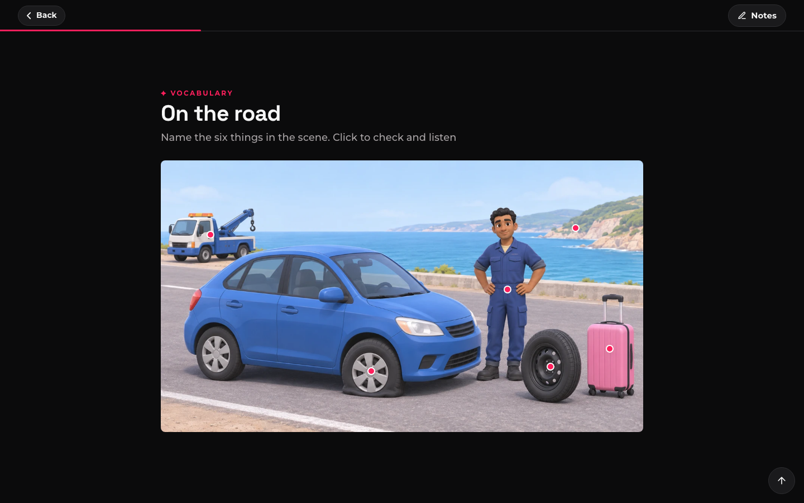
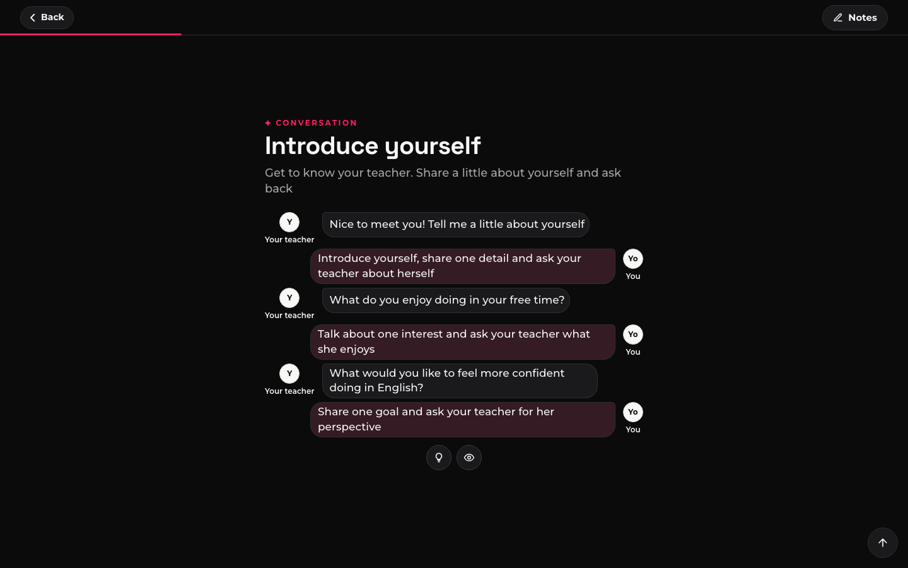
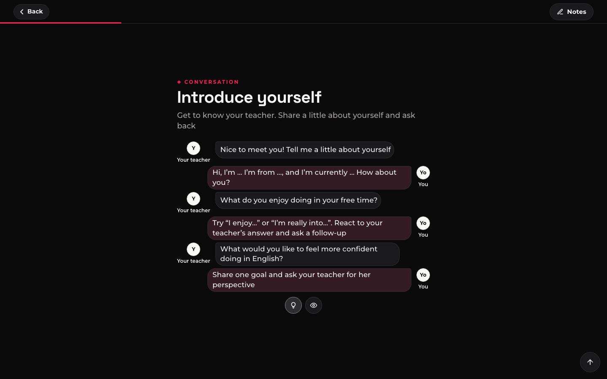
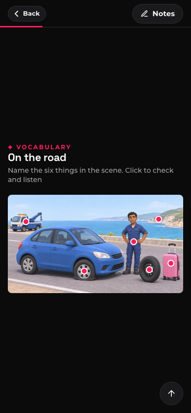
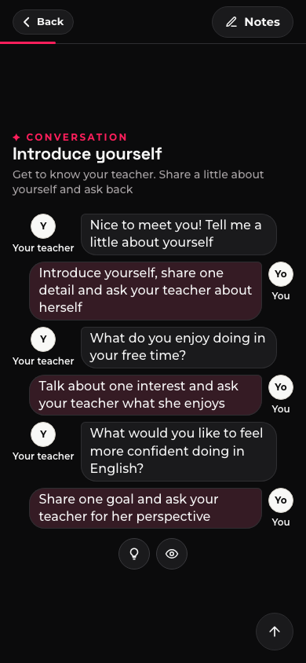
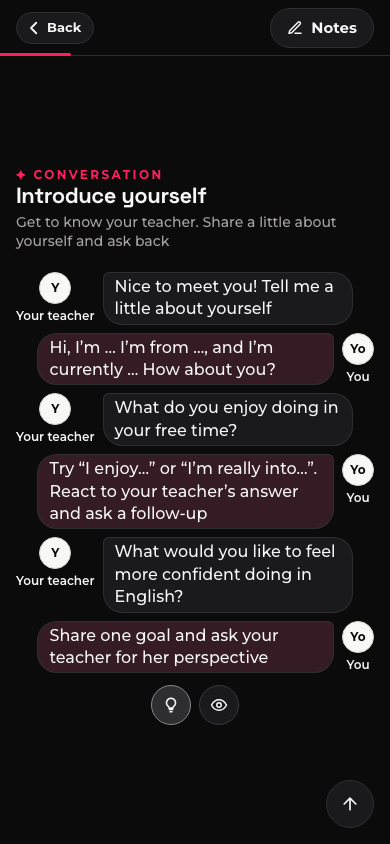
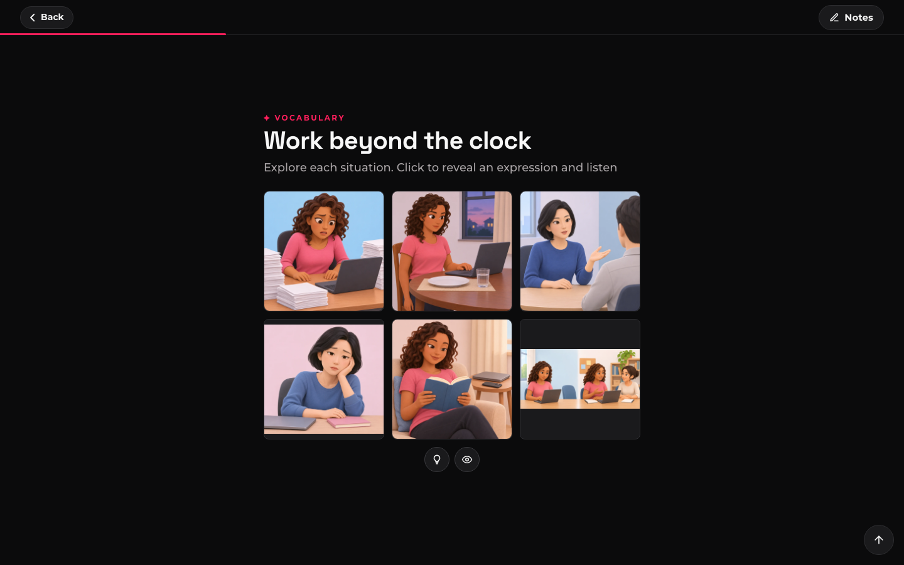
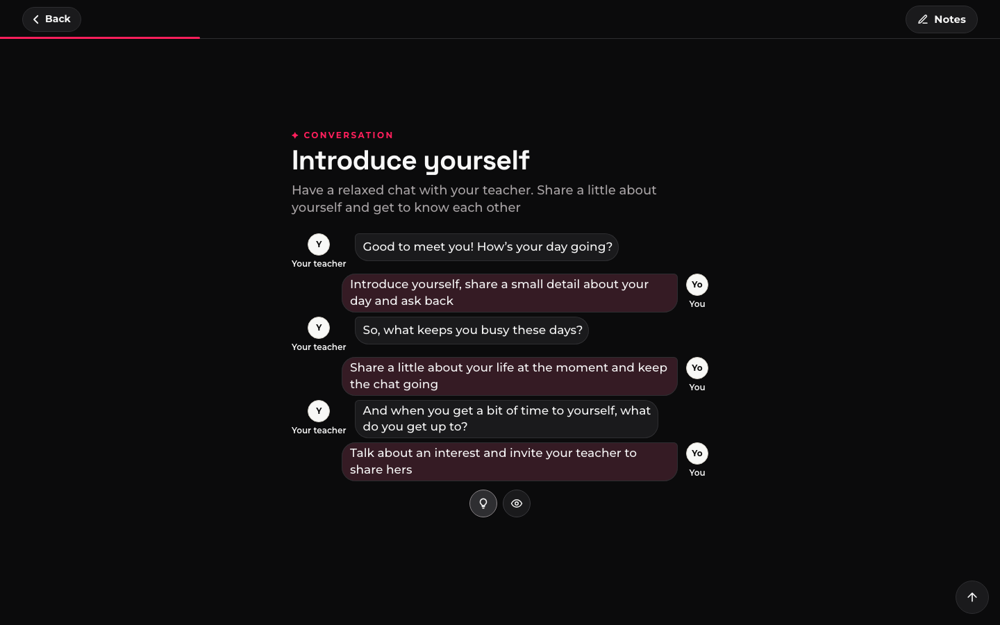
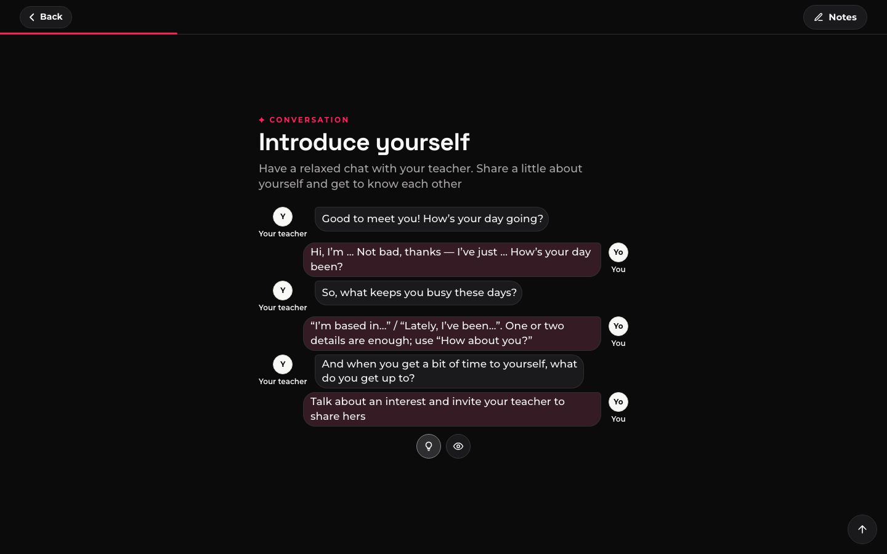
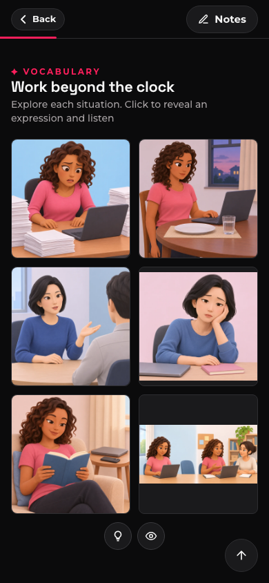

# Evidências

| Antes                                                                                                                                        | Depois                                                                                                                                      |
| -------------------------------------------------------------------------------------------------------------------------------------------- | ------------------------------------------------------------------------------------------------------------------------------------------- |
| B1/B2, 1440px: a segunda página era vocabulário  | B1/B2, 1440px: apresentação após a capa           |
| A apresentação e estes apoios ainda não existiam                                                                                             | B1/B2, 1440px: modelo e dica abertos  |
| B1/B2, 390px: a segunda página era vocabulário    | B1/B2, 390px: apresentação após a capa             |
| A apresentação e estes apoios ainda não existiam                                                                                             | B1/B2, 390px: modelo e dica abertos    |
| C1/C2, 1440px: a segunda página era vocabulário  | C1/C2, 1440px: apresentação após a capa           |
| A apresentação e estes apoios ainda não existiam                                                                                             | C1/C2, 1440px: modelo e dica abertos  |
| C1/C2, 390px: a segunda página era vocabulário    | C1/C2, 390px: apresentação após a capa             |
| A apresentação e estes apoios ainda não existiam                                                                                             | C1/C2, 390px: modelo e dica abertos    |
