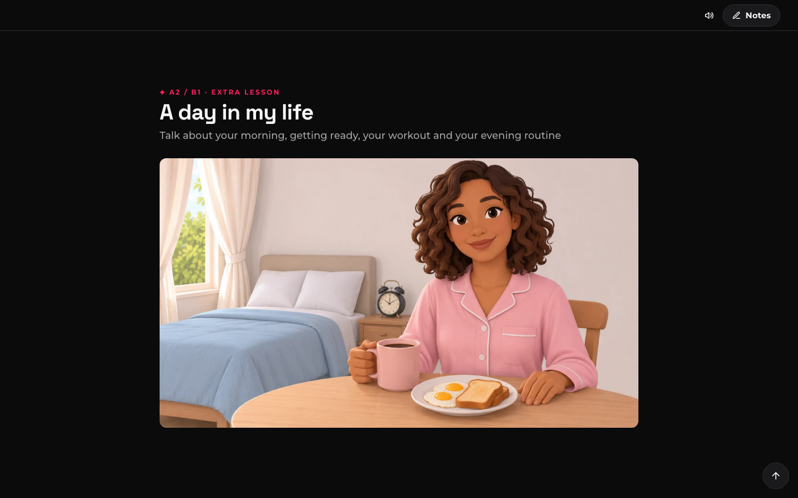
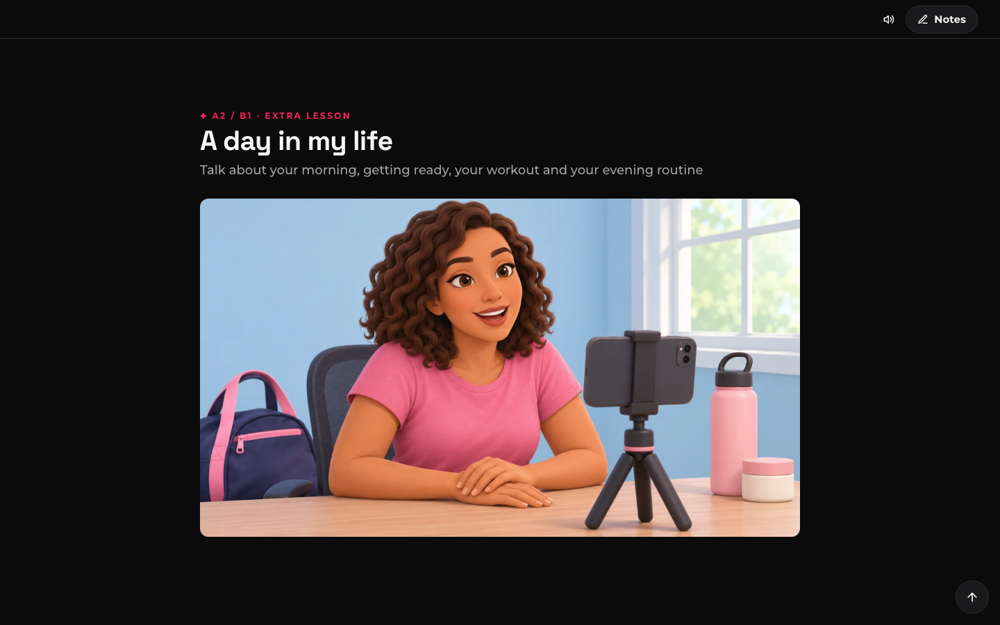
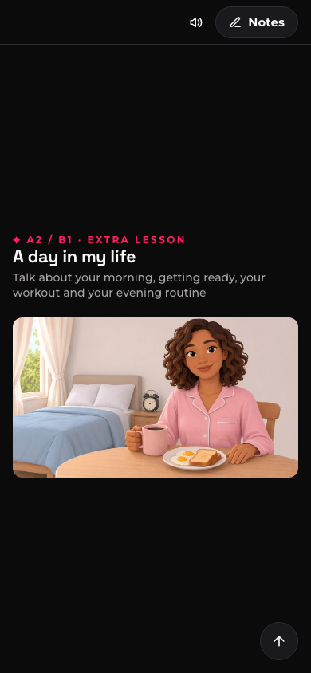
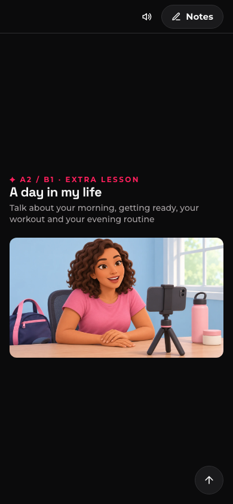

# Capa própria — feedback75

Pedido: diferenciar a capa da segunda página. Nova imagem de Ana gravando conteúdo em casa, com bolsa de treino e skincare, gerada em uma chamada built-in image_gen por texto, sem referências. Prefixo Langy1.8 literal e imutável, SHA256 fb257d5a454e97e9e811d1b9f714b8e6f1c1a462058fe3962af01ec0d3d72489. Resize proporcional para1280×720/WebP, sem corte. Prompt e proveniência em stories/materials/InfluencerRoutine/assets/cover-prompt75.txt e cover-provenance75.json.

Escopo: capa da primeira página e miniatura do catálogo, com alt correspondente. Nenhuma mudança nas18 páginas,4cenas dos exercícios,49áudios, diálogos, layout, props ou navegação. Regra central de capa própria já existente foi aplicada.

Conferência em1440×900 e390×844: capa distinta da cena da manhã, sem overflow;4capturas antes/depois. Pacote/API607 e evidências74 reutilizados: src, dependências e contrato público idênticos. Um export final novo é necessário para vincular os bytes da capa ao commit.

Antes/depois:

| Antes                                  | Depois                                 |
| -------------------------------------- | -------------------------------------- |
|  |  |
|    |    |

Publicação autorizada somente em staging; recibo e handoff finais em /Users/margaridamartins/.codex/outputs/influencer-cover75-20261122/. Sem nova mídia de exercício, produção, backend, npm, merge ou mensagens externas.

Visual gate review: pending human
